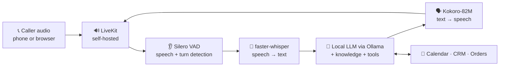

<!-- CallSynt · README by Usama Shahid (fewgets) -->

  
  
  
  
  
  
  

---
> 🚧 **Status: in active development** at **DevSynt**. This repository is a **project showcase**; the
> source code is private. See the [roadmap](#%EF%B8%8F-roadmap) for where we are.

## 📌 Overview

**CallSynt** is a configurable **AI voice-agent platform** that answers and makes phone calls for
businesses. A business creates an agent, uploads its approved information, sets a goal and connects
its tools. The agent then handles **inbound calls** and authorised **outbound calls** in natural spoken English.

| One core engine… | …configured differently for every business |
|---|---|
| Voice engine, call handling, dashboard, logs and security | Knowledge, greeting, questions, workflow, tools and permissions |

**Example agents**
- 📅 **Clinic receptionist:** answers FAQs and books appointments straight into the calendar
- 📦 **Delivery desk:** answers "where is my order?" by looking up the order system
- 🎯 **Lead qualifier:** calls interested leads, asks the qualifying questions and records the result in the CRM

Unlike subscription voice APIs, CallSynt runs on an **open-source, self-hosted voice stack** that we
operate ourselves, which gives full control over data, deployment and cost.

---

## ✨ Key Features

| | Feature | Description |
|:-:|---|---|
| 🏢 | **Multi-tenant** | Separate client workspaces, team roles and credentials from day one |
| 🛠️ | **Agent Builder** | Greeting, goal, questions, allowed actions, with versioned settings |
| 📚 | **Knowledge Base** | Upload approved documents; agents answer only from trusted, versioned sources (RAG) |
| 📞 | **Inbound Routing** | Each business phone number is routed to its own agent |
| 📤 | **Outbound Campaigns** | Contact lists, schedules, consent checks, opt-outs and limited retries |
| 🔌 | **Business Tools** | Validated connectors for booking, CRM, tickets and lookups |
| ✅ | **Call QA** | Transcripts, outcome evidence, failure reasons and a human review queue |
| 📊 | **Operations Dashboard** | Results, costs, alerts, usage caps and audit history |
| 🙋 | **Human Fallback** | Callback, review or transfer, never guessing a sensitive answer |

---

## 🎙️ How the Voice Engine Works

| Step | What happens | Component |
|---|---|---|
| 1. Capture | Receive the caller's phone or microphone audio | LiveKit (self-hosted) |
| 2. Detect | Find speech and pauses; decide when to listen or reply | Silero VAD + turn handling |
| 3. Understand | Convert speech to text | faster-whisper |
| 4. Decide and act | Answer using the conversation, approved knowledge and tools | Local instruction model via Ollama |
| 5. Speak | Convert the reply to natural speech | Kokoro-82M |
| 6. Coordinate | Handle interruptions, cancellation and session state | LiveKit Agents (Python) |

**Interruptions are first-class:** when a caller cuts in, the old reply and its queued audio are
cancelled, and only what the caller actually heard is kept in the conversation history.

---

## 🏗️ Platform Architecture

| Module | What it does | Stack |
|---|---|---|
| Clients and login | Businesses, roles, credentials | Next.js + Supabase Auth, PostgreSQL access policies |
| Agent builder | Versioned agent configuration | Next.js + TypeScript, JSON config |
| Knowledge base | Upload, chunk, embed and search documents | Python, PostgreSQL + pgvector, sentence-transformers |
| Voice sessions | Real-time conversation | LiveKit Agents + Silero + faster-whisper + Ollama + Kokoro |
| Telephony | Inbound and outbound phone calls | LiveKit SIP + SIP carrier |
| Campaigns | Scheduling, consent and retries | FastAPI + Celery + Redis |
| Business tools | Booking / CRM / ticket connectors | FastAPI + Pydantic |
| Call QA | Outcome checks and review queue | Post-call rules + model evaluator |
| Operations | Metrics, alerts, costs | OpenTelemetry, Prometheus, Grafana |
| Deployment | Test and live environments, backups | Docker + GitHub Actions |

---

## 🛡️ Built for Production

- 🔐 **Data protection:** client isolation enforced in every query and tool; encrypted secrets; controlled recording access and retention
- 🧾 **Safe actions:** tool arguments are validated, the backend decides what is allowed, and uploaded documents can't override system rules
- 🔁 **No duplicates:** a unique operation key for every booking or call; results are checked before any retry
- 📵 **Calling compliance:** consent and do-not-call lists rechecked before dialling; time zones, retry caps, opt-outs and a campaign stop button
- 🎯 **Quality gates:** ≥ 100 varied test conversations per workflow, a target of ≥ 95% correct outcomes, and p95 response delay under 2 seconds

---

## 🗺️ Roadmap

| Version | Milestone | Done when |
|---|---|---|
| **V0** | Discovery: interview managers, define 3 workflows and test scenarios | A pilot partner agrees on a measurable problem |
| **V1** | Text agent + mock tool, then speech in and speech out | One local browser voice call works, with latency measured |
| **V2** | LiveKit sessions, interruptions, knowledge, a real tool | Two businesses run on the same core |
| **V3** | SIP carrier, inbound routing, outbound scheduling | Calls work both ways; opt-out and retry tests pass |
| **V4** | Tenant security, QA dashboard, monitoring, load tests | Pilot meets quality and capacity targets |
| **V5** | Onboarding, metering, billing, paid beta | Customers see repeatable value |

**Next milestone:** one local browser voice conversation → one verified action → two business configurations.

---

## 🧰 Tech Stack

  
  
  
  
  
  
  
  
  
  
  
  

---

## 📂 Source Code

CallSynt is a commercial product in development at **DevSynt**, so the source code is private.
**Interested in a pilot, a demo or collaborating?** Get in touch below.

---

## 📜 License

© 2026 Usama Shahid · DevSynt. All rights reserved. This repository is a project showcase; the source code is private.

---

## 🤝 Let's Work Together

**Have an idea, a freelance project, or want to collaborate on something in AI?**
I'm always open to collaborations, freelance work and full-time opportunities.

  

⭐ **If you like this project, please give it a star. It really helps!** ⭐

 

<h3>"Every missed call is a missed customer. Let AI pick up."</h3>

